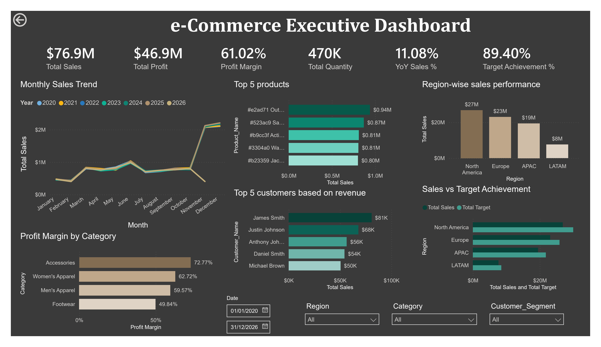
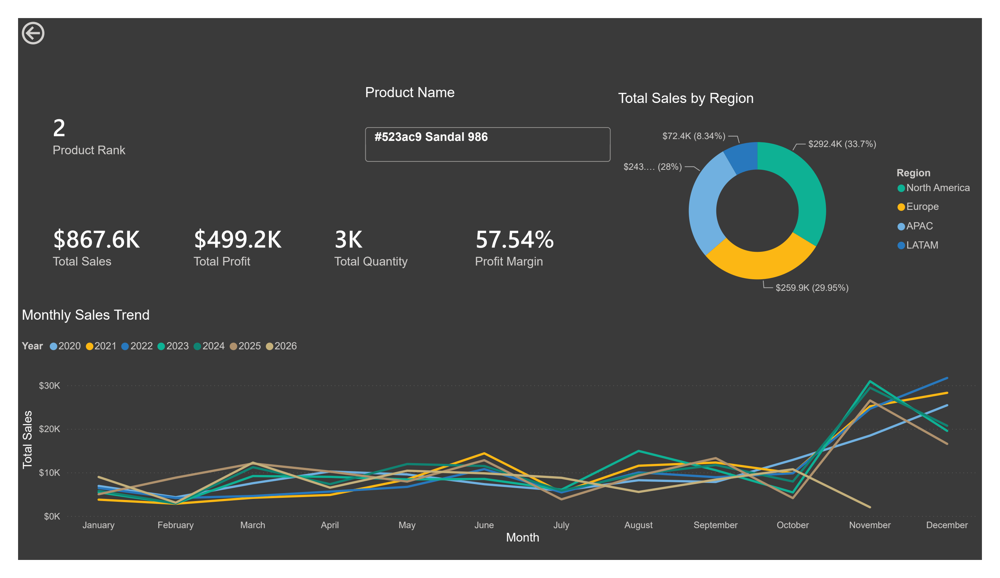
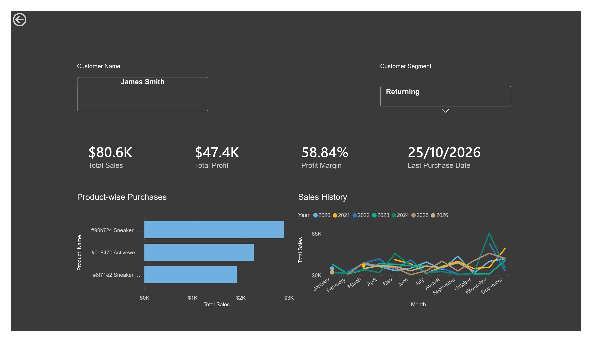

# Retail Sales Performance & Customer Behaviour Dashboard (Power BI)

An interactive Power BI dashboard that helps management identify top-performing products, profitable regions and customer segments, track month-wise sales trends, and compare actual sales against targets.



## Project at a glance

| | |
|---|---|
| **Tool** | Power BI Desktop (DAX, data modelling, drill-through, custom tooltips) |
| **Data** | 250,000 order lines, 192 products, 5,000 customers, 1,328 monthly targets |
| **Period** | 1 Jan 2020 to 6 Nov 2026 |
| **Coverage** | 4 regions, 17 countries, 4 product categories, 4 customer segments |
| **Deliverables** | `.pbix` dashboard, written report, PowerPoint deck |

## Business questions answered

1. Which region contributed the highest total sales?
2. What is the trend of monthly sales over the last two years?
3. Who are the top 5 customers based on revenue?
4. Which product category has the highest profit margin?
5. What percentage of the sales target is achieved this quarter?
6. Is there a correlation between sales quantity and profit?
7. During which month did sales drop significantly?
8. Which customer segment is more profitable?

## Key findings

| Question | Finding |
|---|---|
| Headline KPIs | $76.9M sales, $46.9M profit, 61.0% margin, 469,896 units |
| Top region | North America, $26.8M (34.9% of sales); margins are about 61% in every region |
| Trend | Flat: $11.5M to $11.7M per year since 2020; Jan to Oct 2026 is 1.2% below 2025 |
| Seasonality | Nov and Dec run at about 2.2x an average month; January falls about 78% every year |
| Highest-margin category | Accessories, 72.8% (Footwear is lowest at 49.8%) |
| Target achievement | 88.8% for Q4 to date, 90.1% for Q3 2026, 89.4% overall; none of 83 months hit target |
| Quantity vs profit | Strong at order, customer and month level (r = 0.61 to 0.998), none across products or categories (r about 0.1) |
| Most profitable segment | Returning for total profit ($19.1M); VIP for margin (63.1%) and profit per customer ($10.3K) |
| Discounting | Margin falls from 66% (no discount) to 41% (above 30% discount) |

Read the full analysis in the [final report](reports/Retail_Sales_Final_Report.md) and the [slide deck](reports/Retail_Sales_Dashboard_Deck.pptx).

## Dashboard pages

| Page | What it shows |
|---|---|
| **1. Executive Dashboard** | KPI cards (sales, profit, margin, quantity, YoY %, target achievement), monthly sales vs prior year, top 5 products and customers, region performance, sales vs target, profit margin by category. Slicers: Date, Region, Category, Customer Segment |
| **1.2 Executive Dashboard Addon** | Quantity vs profit by category (scatter), profit and margin by customer segment |
| **2. Product Drill-Through** | Product name, sales, profit, quantity, margin, monthly trend, region split, sales rank |
| **3. Customer Drill-Through** | Customer name and segment, sales history, profitability, product-wise purchases, last purchase date |
| **Custom Tooltip** | Contribution % of total sales, YoY %, product rank, last purchase date |

Drill-through: right-click any product or customer name and choose **Drill through**.




## Data model

Star schema with `Fact_Sales` at the centre.

| Table | Rows | Role |
|---|---|---|
| `Fact_Sales` | 250,000 | Order lines: quantity, discount, net sales, cost, profit, region, country, channel |
| `Dim_Product` | 192 | Product name, category, sub-category |
| `Dim_Customer` | 5,000 | Customer name and segment |
| `Date_Table` | 2,557 | Calendar (year, quarter, month) |
| `Monthly_Sales_Targets` | 1,328 | Target by month, region and category (linked via DAX `TREATAS`) |
| `_Measures` | n/a | Holder table for DAX measures |

Relationships: `Fact_Sales[Order_Date]` to `Date_Table[Date]`, `Fact_Sales[Customer_ID]` to `Dim_Customer`, `Fact_Sales[Product_ID]` to `Dim_Product` (all many-to-one).

### Key DAX measures

| Measure | Purpose |
|---|---|
| `Total Sales` | `SUM(Fact_Sales[Net_Sales])` (after discounts) |
| `Total Profit`, `Profit Margin` | Profit and profit / sales |
| `Total Quantity` | Units sold |
| `Sales PY`, `YoY Sales %` | Same period last year and growth |
| `Total Target`, `Target Achievement %` | Target for the current Month / Region / Category context and sales / target |
| `Product Rank` | Dense rank of the product by sales |
| `Last Purchase Date` | Latest order date |
| `Contribution %` | Share of total sales |

All definitions are exported in [`model_metadata/measures.csv`](model_meta_data/measures.csv).

## Repository structure

```
.
├── README.md
├── data/                 Raw source files (sales and targets CSVs)
├── power_bi/             PowerBI_retail.pbix
├── model_metadata/       Exported measures, relationships and column definitions
├── scripts/              Helper scripts
├── reports/              Final report (Markdown) and PowerPoint deck
└── images/               Dashboard screenshots used in this README
```

## How to open the dashboard

1. Install [Power BI Desktop](https://powerbi.microsoft.com/desktop/) (Windows).
2. Open `power_bi/PowerBI_retail.pbix`.
3. If prompted, update the data source paths to point to the CSVs in `data/` (Home, Transform data, Data source settings).

## Notes and limitations

- 2026 is a partial year (data ends 6 Nov 2026), so YoY on 2026 or November 2026 needs a like-for-like comparison period.
- Customer names are not unique (177 names are shared by more than one customer ID), so name-level views combine different customers.
- The target table runs to 6 Nov 2026 with no December 2026 target.
- Segment, region and channel margins are very uniform, so most profit variation comes from category and discount depth.

## Skills demonstrated

Data modelling (star schema), DAX (time intelligence, `TREATAS`, `RANKX`, context transition), interactive dashboard design, drill-through and tooltip pages, exploratory analysis and business storytelling.

## Author

**Abhijith Suresh** | [LinkedIn](https://www.linkedin.com/in/ab-suresh) | [Email](abhijithsureshofficial@gmail.com.com)

